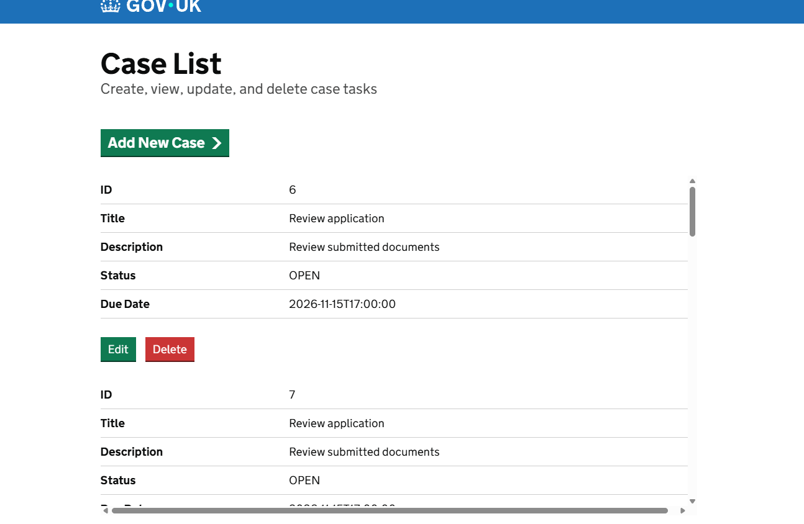
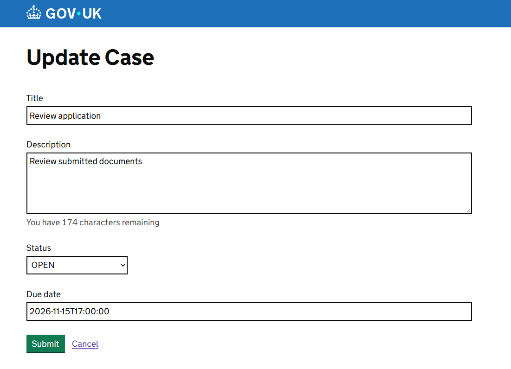

# HMCTS Dev Test Frontend

A case management frontend built with Express and TypeScript, GOV.UK Frontend components, and Nunjucks templates. It lists, creates, edits, and deletes cases through a backend API.



## Run locally

Install dependencies and build the frontend assets:

```sh
yarn install
yarn webpack
```

Start the case API on `http://localhost:4000`, then start the frontend:

```sh
yarn start:dev
```

The frontend requests cases from `GET http://localhost:4000/cases/`. It uses the same API base for create (`POST /cases/`), update (`PUT /cases/:id`), and delete (`DELETE /cases/:id`).

## Forms and validation



The add and edit pages share their title, description, status, and due-date fields through `src/main/views/macros/case-form-fields.njk`.

- Description uses the GOV.UK character-count component with a 2000-character limit. The counter gives users feedback in the browser.
- The server independently checks that the description is a string of no more than 2000 characters on both create and update. Invalid submissions return HTTP 400, display an inline error, and preserve the submitted values without calling the API.
- Status is selected from `OPEN`, `IN_PROGRESS`, `COMPLETED`, or `CANCELLED`. New cases default to `OPEN`.
- Required fields also use HTML `required` attributes for browser validation.
